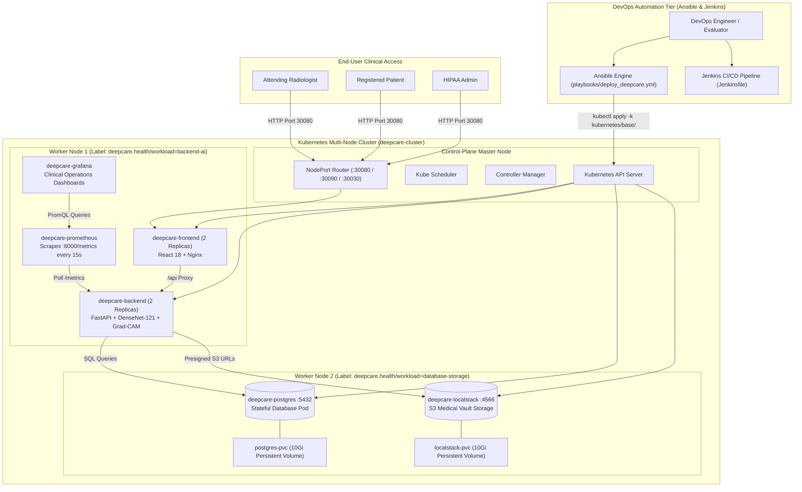

# DeepCare — Enterprise DevOps Architecture & Setup Guide
## Ansible Automation & Multi-Node Kubernetes Cluster Integration

---

## 1. Executive Summary & Architecture Overview

**DeepCare** is a clinical-grade healthcare platform combining deep learning-powered chest radiograph pathology detection (DenseNet-121 with Grad-CAM visual heatmaps), electronic health records (EHR), certified doctor diagnostic workflows, and automated cloud infrastructure.

This guide details the **DevOps extension** integrated into DeepCare:
1. **Ansible Automation Layer (`ansible/`):** Idempotent configuration management, node preparation, and deployment automation.
2. **Multi-Node Kubernetes Architecture (`kubernetes/`):** High-availability container orchestration across 3 nodes (1 Control Plane + 2 Workers) with persistent storage and health checking.
3. **Preservation of Existing Workflows:** Complete isolation between existing Docker Compose/Terraform workflows and new DevOps layers without modifying any core application code.

---

## 2. End-to-End System Architecture Diagram



---

## 3. Directory Layout Comparison

The repository maintains clean separation between existing application services and new DevOps automation:

```
deepcare/
├── backend/                       # FASTAPI BACKEND (UNTOUCHED)
├── frontend/                      # REACT FRONTEND (UNTOUCHED)
├── docker-compose.yml             # LOCAL DOCKER COMPOSE WORKFLOW (UNTOUCHED)
├── infrastructure/
│   ├── k8s/                       # Existing k8s manifests (UNTOUCHED)
│   ├── monitoring/                # Existing prometheus/grafana configs (UNTOUCHED)
│   └── terraform/                 # AWS infrastructure code (UNTOUCHED)
│
├── ansible/                       # NEW: ANSIBLE AUTOMATION LAYER
│   ├── ansible.cfg                # Engine & SSH configuration
│   ├── inventory/
│   │   ├── local.ini              # Local dev target (KIND/Minikube/Docker Desktop)
│   │   └── cluster.ini            # 3-Node production cluster target
│   ├── group_vars/
│   │   ├── all.yml                # Global app variables, images, and ports
│   │   └── kubernetes.yml         # Kernel modules, sysctl, and resource limits
│   ├── playbooks/
│   │   ├── setup_environment.yml  # System prerequisites & CLI auditing
│   │   ├── install_docker.yml     # Container runtime verification
│   │   ├── install_kubernetes.yml # Node preparation & swap/sysctl configuration
│   │   ├── configure_nodes.yml    # Node labeling & topology assignment
│   │   └── deploy_deepcare.yml    # Automated rollout & smoke testing
│   ├── roles/
│   │   ├── docker/                # Docker installation & cgroup tasks
│   │   ├── kubernetes/            # Kubernetes node setup & CNI tasks
│   │   └── deepcare/              # Workload deployment & verification tasks
│   ├── templates/
│   │   └── kind-cluster.yaml.j2   # KIND 3-node cluster template
│   └── README.md
│
└── kubernetes/                    # NEW: MULTI-NODE KUBERNETES MANIFESTS
    ├── base/
    │   ├── namespace.yaml         # 'deepcare' namespace
    │   ├── configmap.yaml         # Application parameters
    │   ├── secrets-template.yaml  # Secure credentials template
    │   ├── postgres-deployment.yaml
    │   ├── postgres-service.yaml  # ClusterIP only (non-public)
    │   ├── localstack-deployment.yaml
    │   ├── localstack-service.yaml
    │   ├── backend-deployment.yaml# 2 Replicas with liveness/readiness probes
    │   ├── backend-service.yaml
    │   ├── frontend-deployment.yaml
    │   ├── frontend-service.yaml  # NodePort :30080
    │   └── kustomization.yaml
    ├── overlays/
    │   ├── local/
    │   │   ├── kind-cluster.yaml  # Multi-node (1 Master + 2 Workers)
    │   │   ├── service-nodeport-patch.yaml
    │   │   └── kustomization.yaml
    │   └── production/
    │       ├── ingress.yaml       # Ingress routing
    │       └── kustomization.yaml
    ├── monitoring/
    │   ├── prometheus.yaml        # Prometheus scraper (:30090)
    │   ├── grafana.yaml           # Grafana dashboard (:30030)
    │   └── kustomization.yaml
    ├── storage/
    │   ├── persistent-volumes.yaml# Non-ephemeral PVCs (10Gi each)
    │   └── storageclass.yaml
    └── README.md
```

---

## 4. Step-by-Step Deployment Guide

### Phase 1: Cluster Provisioning

#### Option A: 3-Node Cluster via KIND (Recommended)
```bash
# Create the 1 control-plane + 2 worker cluster
kind create cluster --config kubernetes/overlays/local/kind-cluster.yaml

# Verify nodes are Ready
kubectl get nodes -o wide
```

#### Option B: 3-Node Cluster via Minikube
```bash
minikube start --nodes 3 -p deepcare-cluster
```

#### Option C: Existing Kubernetes (Docker Desktop)
```bash
kubectl config use-context docker-desktop
```

---

### Phase 2: Automated Deployment via Ansible

You can deploy the complete stack using Ansible playbooks.

```bash
# 1. Audit Environment Prerequisites
ansible-playbook -i ansible/inventory/local.ini ansible/playbooks/setup_environment.yml

# 2. Check Node Runtime
ansible-playbook -i ansible/inventory/local.ini ansible/playbooks/install_docker.yml

# 3. Prepare Kubernetes Cluster Nodes
ansible-playbook -i ansible/inventory/local.ini ansible/playbooks/install_kubernetes.yml

# 4. Configure Multi-Node Topology & Labels
ansible-playbook -i ansible/inventory/local.ini ansible/playbooks/configure_nodes.yml

# 5. Deploy DeepCare Applications & Run Smoke Tests
ansible-playbook -i ansible/inventory/local.ini ansible/playbooks/deploy_deepcare.yml
```

*Note: If running directly on Windows without native Ansible, you can either run the playbooks inside WSL or run via Docker:*
```powershell
docker run --rm -it -v "${PWD}:/workspace" -w /workspace/ansible --network host williamyeh/ansible:alpine3 ansible-playbook -i inventory/local.ini playbooks/deploy_deepcare.yml
```

---

### Phase 3: Direct Kubernetes Deployment via Kustomize (Native CLI)

```bash
# Deploy all base resources
kubectl apply -k kubernetes/base/

# Or deploy using the local overlay with NodePort mappings
kubectl apply -k kubernetes/overlays/local/
```

---

## 5. Service Verification & Access URLs

Once deployed, all services are accessible via the configured NodePorts:

| Service | URL | Default Credentials | Verification Command |
|---|---|---|---|
| **DeepCare Web Application** | [http://localhost:30080](http://localhost:30080) | `dr.sarah@deepcare.health` / `DoctorPass123!` | `curl.exe -I http://localhost:30080` |
| **FastAPI Swagger Docs** | [http://localhost:30080/docs](http://localhost:30080/docs) | — | `curl.exe -I http://localhost:30080/docs` |
| **Backend Liveness Probe** | [http://localhost:30080/health/live](http://localhost:30080/health/live) | — | `curl.exe http://localhost:30080/health/live` |
| **Backend Readiness Probe** | [http://localhost:30080/health/ready](http://localhost:30080/health/ready) | — | `curl.exe http://localhost:30080/health/ready` |
| **Prometheus Telemetry** | [http://localhost:30090](http://localhost:30090) | — | `curl.exe http://localhost:30090/-/healthy` |
| **Grafana Dashboards** | [http://localhost:30030](http://localhost:30030) | `admin` / `admin` | `curl.exe http://localhost:30030/api/health` |

---

## 6. How to Verify Application Components

### 1. Verify Frontend Access
```bash
curl.exe -I http://localhost:30080
# Expected output: HTTP/1.1 200 OK
```

### 2. Verify Backend Health Probes
```bash
# Liveness Probe
curl.exe -s http://localhost:30080/health/live
# Response: {"status":"alive","service":"DeepCare API"}

# Readiness Probe
curl.exe -s http://localhost:30080/health/ready
# Response: {"status":"ready","database":"connected"}
```

### 3. Verify PostgreSQL Persistent Storage
```bash
# Check PVC bound status
kubectl get pvc -n deepcare
# Output: postgres-pvc Bound

# Verify data persistence by inspecting tables inside the pod
kubectl exec -it deployment/deepcare-postgres -n deepcare -- psql -U deepcare_user -d deepcare -c "\dt"
```

---

## 7. Scaling & Rolling Update Operations

### Dynamic Scaling
Scale backend replicas up to handle peak clinical image processing loads:
```bash
# Scale backend to 4 replicas
kubectl scale deployment deepcare-backend --replicas=4 -n deepcare

# Scale frontend to 3 replicas
kubectl scale deployment deepcare-frontend --replicas=3 -n deepcare

# Check running replicas
kubectl get pods -n deepcare -l app.kubernetes.io/component=api-backend
```

### Zero-Downtime Rolling Updates
```bash
# Trigger rollout restart
kubectl rollout restart deployment deepcare-backend -n deepcare

# Track rollout status in real-time
kubectl rollout status deployment deepcare-backend -n deepcare

# View historical revisions
kubectl rollout history deployment deepcare-backend -n deepcare

# Rollback to previous version if needed
kubectl rollout undo deployment deepcare-backend -n deepcare
```

---

## 8. Cluster Teardown & Docker Compose Preservation

### Preserving Existing Docker Compose Workflow
Your original local stack remains 100% functional:
```bash
# Start Docker Compose without touching Kubernetes
docker-compose up -d

# Stop Docker Compose
docker-compose down
```

### Shutting Down the Kubernetes Cluster
```bash
# Delete all resources in the namespace
kubectl delete -k kubernetes/base/

# If using KIND:
kind delete cluster --name deepcare-cluster

# If using Minikube:
minikube stop -p deepcare-cluster
```

---

## 9. Troubleshooting & FAQ

| Issue | Root Cause | Solution |
|---|---|---|
| Pods stuck in `Pending` | Storage provisioner not bound or insufficient CPU/RAM | Check `kubectl describe pod <pod-name> -n deepcare` and ensure Docker Desktop has at least 4GB RAM allocated. |
| Backend pod restarts (`CrashLoopBackOff`) | PostgreSQL is still initializing tables | The `readinessProbe` with `initialDelaySeconds: 15` will auto-retry until the database is ready. |
| Port 30080 collision | Another service is using host port 30080 | Modify `nodePort` in `kubernetes/base/frontend-service.yaml` or use `kubectl port-forward svc/deepcare-frontend 8080:80 -n deepcare`. |

---

## 10. Viva / Interview Questions and Answers (Ansible & Kubernetes)

### Q1: Why use Ansible alongside Kubernetes instead of using just one tool?
> **Answer:** Ansible and Kubernetes solve different problems at different layers of the infrastructure stack. Ansible is an **orchestration and configuration management tool** designed to manage infrastructure lifecycle (setting up operating systems, installing container runtimes, bootstrapping Kubernetes clusters, configuring network policies, and triggering deployment workflows). Kubernetes is a **container orchestrator** that manages the runtime lifecycle of containerized applications (scheduling pods, self-healing, horizontal autoscaling, service discovery, and rolling updates). In DeepCare, Ansible automates cluster preparation and manifest application, while Kubernetes maintains application state and resilience.

### Q2: How does the Kubernetes deployment ensure zero-downtime rolling updates?
> **Answer:** In `kubernetes/base/backend-deployment.yaml`, the rolling update strategy specifies:
> ```yaml
> strategy:
>   type: RollingUpdate
>   rollingUpdate:
>     maxSurge: 1
>     maxUnavailable: 0
> ```
> `maxUnavailable: 0` guarantees that Kubernetes will never terminate an existing healthy pod until a new replacement pod passes its `readinessProbe` (`/health/ready`). This ensures uninterrupted service for radiologists and patients.

### Q3: How is PostgreSQL persistence guaranteed in this Kubernetes setup?
> **Answer:** PostgreSQL utilizes a `PersistentVolumeClaim` (`postgres-pvc`) mounted at `/var/lib/postgresql/data` with `accessModes: [ReadWriteOnce]`. The deployment strategy is configured with `type: Recreate` so that a new PostgreSQL pod attaches to the same physical disk storage claim upon restart, preventing data corruption and avoiding ephemeral container volume loss.

### Q4: Why is the database service configured as `ClusterIP` instead of `NodePort` or `LoadBalancer`?
> **Answer:** For HIPAA compliance and medical data security, the clinical database must **never be exposed to the public internet**. By setting `type: ClusterIP` in `kubernetes/base/postgres-service.yaml`, the PostgreSQL instance is accessible **only to internal pods** within the cluster (like `deepcare-backend`), preventing unauthorized external network scanning and attack vectors.

### Q5: How does Ansible achieve idempotency across playbooks?
> **Answer:** Ansible modules (such as `apt`, `service`, `copy`, `sysctl`, and `command` with `changed_when`) verify the desired state before taking action. For instance, in `install_docker.yml`, Ansible first checks `docker --version`. If Docker is already installed and running, it reports `ok` (green) rather than attempting re-installation (`changed`), preventing unnecessary restarts or state drift.

