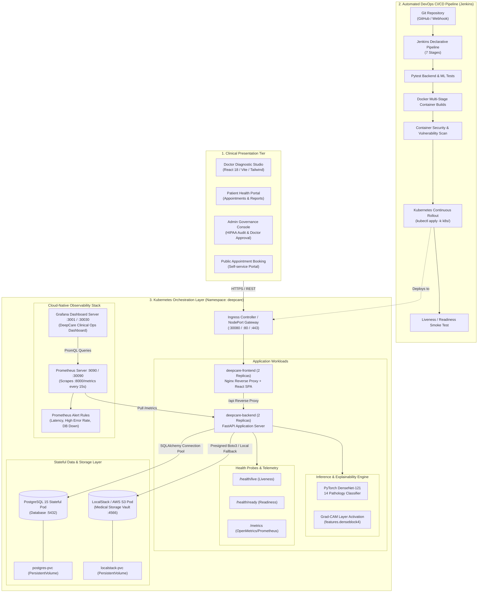

# DeepCare — Cloud-Based Intelligent Healthcare Management & Medical Image Analysis System

[](https://fastapi.tiangolo.com)
[](https://pytorch.org)
[](https://kubernetes.io)
[](https://www.jenkins.io)
[](https://prometheus.io)
[](https://grafana.com)
[](https://react.dev)
[](https://www.terraform.io)
[](https://www.hhs.gov/hipaa)

**DeepCare** is an enterprise-grade, HIPAA-compliant cloud-native healthcare platform combining deep learning-powered chest radiograph pathology detection (DenseNet-121 with Grad-CAM visual heatmaps), electronic health records (EHR), certified doctor diagnostic workflows, automated Jenkins CI/CD pipelines, Kubernetes container orchestration, and real-time Prometheus & Grafana observability.

---

## 🏛️ System Architecture

DeepCare is engineered with a modular, highly available, cloud-native architecture supporting both local multi-container orchestration (Docker Compose) and production-grade Kubernetes cluster deployments with end-to-end automated CI/CD and metrics observability.



### Architectural Subsystems Breakdown

1. **Clinical Presentation Layer (Frontend):**
   - Built with **React 18**, **TypeScript**, **Vite**, and **Tailwind CSS**.
   - Implements Role-Based Access Control (RBAC) across Attending Physicians, Registered Patients, and HIPAA Compliance Administrators.
   - Includes the interactive **Deep Learning X-Ray Studio** featuring real-time **Side-by-Side** inspection and layered **Blend Mode** with dynamic opacity sliders comparing raw radiographs directly with Grad-CAM heatmaps.

2. **Backend & AI Inference Engine:**
   - **FastAPI** high-performance asynchronous web framework.
   - **PyTorch DenseNet-121** pre-trained on the NIH ChestX-ray14 benchmark dataset (119 sequential real clinical studies included).
   - Generates localized saliency maps using **Grad-CAM** backpropagation on `features.denseblock4.denselayer16.conv2`.
   - Generates cryptographic, HIPAA-compliant PDF clinical diagnostic reports via ReportLab.

3. **Cloud-Native Kubernetes Infrastructure (`infrastructure/k8s`):**
   - **Namespace Isolation:** Dedicated `deepcare` namespace for complete workload segmentation.
   - **Zero-Downtime Rolling Updates:** Replicas configured with rolling update strategies and resource boundaries.
   - **Resilient Probes:** Integrated `/health/live` (process responsiveness) and `/health/ready` (database connectivity verification) health probes.
   - **Persistent Storage:** PersistentVolumeClaims (`postgres-pvc`, `localstack-pvc`) ensure durability across pod restarts and rescheduling.

4. **Continuous Integration & Deployment (Jenkins CI/CD):**
   - Complete declarative [`Jenkinsfile`](./Jenkinsfile) automating 7 production pipeline stages: checkout, backend pytest suite (18 unit & integration tests), frontend Vite compilation, Docker container builds, security vulnerability scanning, rolling deployment via Kustomize, and post-deployment smoke tests.

5. **Observability, Metrics & Telemetry (Prometheus + Grafana):**
   - Exposed OpenMetrics endpoint via `prometheus-fastapi-instrumentator` at `/metrics`.
   - Custom clinical telemetry: `deepcare_xrays_ingested_total`, `deepcare_ai_inferences_total`, `deepcare_ai_inference_duration_seconds`, `deepcare_reports_generated_total`, and `deepcare_database_health`.
   - Pre-configured Grafana Clinical Operations dashboard visualizing request throughput, p95/p99 latency, AI inference duration distributions, active system users, and service uptime.
   - Automated Prometheus alerting rules for high inference latency (>3.0s), API error rates (>5%), and database connection loss.

---

## 🔬 Deep Learning & Radiology Pipeline

- **Architecture:** DenseNet-121 with custom transfer learning classification head.
- **Pathologies Classified (14 NIH ChestX-ray 14 Conditions):**
  1. Pneumonia
  2. Infiltration
  3. Effusion
  4. Atelectasis
  5. Consolidation
  6. Cardiomegaly
  7. Pneumothorax
  8. Edema
  9. Emphysema
  10. Fibrosis
  11. Pleural Thickening
  12. Hernia
  13. Mass
  14. Nodule
- **Visual Explainability:** Gradient-weighted Class Activation Mapping (**Grad-CAM**) computes gradient flows through the final dense block (`features.denseblock4`), generating localized heatmaps overlaid onto raw radiographs.
- **Inference Telemetry:** Inference latency (p50, p95, p99) is dispatched to Amazon CloudWatch under namespace `DeepCare/Healthcare`.

---

## 🔐 Security & HIPAA Compliance

| Requirement | Implementation |
|---|---|
| **Data Encryption at Rest** | Amazon S3 with AWS KMS (`aws:kms`) and Amazon RDS with encrypted GP3 storage |
| **Data Encryption in Transit**| TLS 1.3 enforced on AWS ALB and HTTPS REST endpoints |
| **Access Control** | Role-Based Access Control (RBAC) with JWT Bearer tokens (Doctor, Patient, Admin) |
| **Audit Logging** | Immutable database and CloudWatch audit trail of all access to PHI (Protected Health Information) |
| **Network Isolation** | 3-tier VPC architecture isolating database and application workloads into private subnets |

---

## 🚀 Quickstart & Deployment Options

You can run DeepCare using either **Kubernetes (Cloud-Native)** or **Docker Compose**:

### Option A: Kubernetes Cluster Deployment (Recommended for Cloud-Native)

```powershell
# 1. Automated one-click rollout to Kubernetes (PowerShell)
.\scripts\k8s-deploy.ps1

# Or deploy natively using Kustomize:
kubectl apply -k infrastructure/k8s/
```

Verify that all workloads are healthy in the `deepcare` namespace:
```bash
kubectl get pods -n deepcare
```

### Option B: Local Multi-Container Stack with Docker Compose

```bash
# Launch PostgreSQL, LocalStack, FastAPI, React, Prometheus, and Grafana
docker-compose up --build -d

# Seed database with certified doctors, patients, and 119 NIH ChestXray14 scans
python scripts/seed_demo_data.py
```

---

## 🌐 Application & Monitoring Portals

| Service / Portal | Docker URL | Kubernetes (NodePort) | Default Credentials | Description |
|---|---|---|---|---|
| **Web Application** | [http://localhost:3000](http://localhost:3000) | [http://localhost:30080](http://localhost:30080) | *(See table below)* | Doctor, Patient & Admin Portals |
| **FastAPI Swagger API** | [http://localhost:8000/docs](http://localhost:8000/docs) | [http://localhost:30080/docs](http://localhost:30080/docs) | — | Interactive OpenAPI Documentation |
| **Prometheus Metrics** | [http://localhost:9090](http://localhost:9090) | [http://localhost:30090](http://localhost:30090) | — | Application & Infrastructure Scraper |
| **Grafana Monitoring** | [http://localhost:3001](http://localhost:3001) | [http://localhost:30030](http://localhost:30030) | `admin` / `admin` | DeepCare Clinical Ops Dashboard |
| **Kubernetes Dashboard**| — | [https://localhost:30443](https://localhost:30443) | *(Token generated)* | Cluster Workload Manager |
| **Health Liveness Probe**| [http://localhost:8000/health/live](http://localhost:8000/health/live) | [http://localhost:30080/health/live](http://localhost:30080/health/live) | — | Process Liveness Status |
| **Health Readiness Probe**| [http://localhost:8000/health/ready](http://localhost:8000/health/ready) | [http://localhost:30080/health/ready](http://localhost:30080/health/ready) | — | Database Connectivity Status |

---

## 🔑 Pre-Configured Demo Credentials

| Role | Email | Password | Primary Features |
|---|---|---|---|
| **Doctor** | `dr.sarah@deepcare.health` | `DoctorPass123!` | Upload scans, interactive Grad-CAM studio, sign reports |
| **Patient** | `john.doe@patient.deepcare.health` | `PatientPass123!` | View radiographs, download official PDF reports, appointments |
| **Admin** | `admin@deepcare.health` | `AdminPass123!` | Doctor licensing queue, CloudWatch telemetry, HIPAA audit trail |

---

## ☁️ Production Deployment with Terraform

Deploy the full AWS infrastructure (VPC, S3, RDS, EC2 ASG, ALB, CloudWatch, IAM) in minutes:

```bash
cd infrastructure/terraform/environments/dev

# Initialize Terraform AWS providers
terraform init

# Validate architecture plan
terraform plan

# Provision AWS resources
terraform apply -auto-approve
```

---

## 🧪 Testing

```bash
# Run backend test suite
pytest tests/backend/ -v

# Run neural network architecture test
pytest tests/backend/test_ml.py -v
```

---

## 📄 License
This project is licensed under the Apache 2.0 License.
