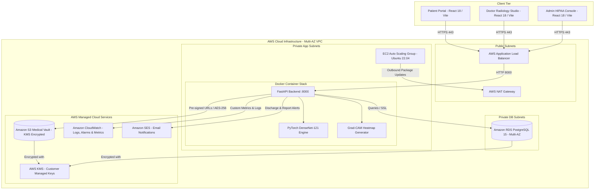

# DeepCare — Cloud-Based Intelligent Healthcare Management & Medical Image Analysis System

[](https://fastapi.tiangolo.com)
[](https://pytorch.org)
[](https://aws.amazon.com)
[](https://react.dev)
[](https://www.terraform.io)
[](https://www.hhs.gov/hipaa)

**DeepCare** is a production-grade, HIPAA-compliant cloud healthcare platform combining deep learning-powered chest radiograph pathology detection (DenseNet-121 with Grad-CAM heatmaps), electronic health records (EHR), certified doctor diagnostic workflows, and automated AWS cloud infrastructure.

---

## 🏛️ System Architecture



---

## 🔬 Deep Learning & Radiology Pipeline

- **Architecture:** DenseNet-121 with custom transfer learning classification head.
- **Pathologies Classified (14 NIH ChestX-ray 14 Conditions):**
  1. Pneumonia
  2. Infiltration
  3. Effusion
  4. Atelectasis
  5. Consolidation
  6. Cardiomegaly
  7. Pneumothorax
  8. Edema
  9. Emphysema
  10. Fibrosis
  11. Pleural Thickening
  12. Hernia
  13. Mass
  14. Nodule
- **Visual Explainability:** Gradient-weighted Class Activation Mapping (**Grad-CAM**) computes gradient flows through the final dense block (`features.denseblock4`), generating localized heatmaps overlaid onto raw radiographs.
- **Inference Telemetry:** Inference latency (p50, p95, p99) is dispatched to Amazon CloudWatch under namespace `DeepCare/Healthcare`.

---

## 🔐 Security & HIPAA Compliance

| Requirement | Implementation |
|---|---|
| **Data Encryption at Rest** | Amazon S3 with AWS KMS (`aws:kms`) and Amazon RDS with encrypted GP3 storage |
| **Data Encryption in Transit**| TLS 1.3 enforced on AWS ALB and HTTPS REST endpoints |
| **Access Control** | Role-Based Access Control (RBAC) with JWT Bearer tokens (Doctor, Patient, Admin) |
| **Audit Logging** | Immutable database and CloudWatch audit trail of all access to PHI (Protected Health Information) |
| **Network Isolation** | 3-tier VPC architecture isolating database and application workloads into private subnets |

---

## 🚀 Quickstart — Local Development with Docker

Run the complete platform locally using Docker Compose and LocalStack (AWS mock environment):

### 1. Prerequisites
- Docker & Docker Compose
- Node.js 18+ (for local frontend dev)
- Python 3.11+ (for local backend dev)

### 2. Launch Stack
```bash
# Clone and enter directory
cd deepcare

# Launch PostgreSQL, LocalStack (S3 + CloudWatch), FastAPI, and React
docker-compose up --build -d
```

### 3. Seed Demo Data
```bash
# Populate database with certified doctors, patients, and sample X-rays
python scripts/seed_demo_data.py
```

### 4. Access DeepCare
- **Web Application:** [http://localhost:3000](http://localhost:3000)
- **FastAPI OpenAPI Swagger Docs:** [http://localhost:8000/docs](http://localhost:8000/docs)
- **Health Check Endpoint:** [http://localhost:8000/health](http://localhost:8000/health)

---

## 🔑 Pre-Configured Demo Credentials

| Role | Email | Password | Primary Features |
|---|---|---|---|
| **Doctor** | `dr.sarah@deepcare.health` | `DoctorPass123!` | Upload scans, interactive Grad-CAM studio, sign reports |
| **Patient** | `john.doe@patient.deepcare.health` | `PatientPass123!` | View radiographs, download official PDF reports, appointments |
| **Admin** | `admin@deepcare.health` | `AdminPass123!` | Doctor licensing queue, CloudWatch telemetry, HIPAA audit trail |

---

## ☁️ Production Deployment with Terraform

Deploy the full AWS infrastructure (VPC, S3, RDS, EC2 ASG, ALB, CloudWatch, IAM) in minutes:

```bash
cd infrastructure/terraform/environments/dev

# Initialize Terraform AWS providers
terraform init

# Validate architecture plan
terraform plan

# Provision AWS resources
terraform apply -auto-approve
```

---

## 🧪 Testing

```bash
# Run backend test suite
pytest tests/backend/ -v

# Run neural network architecture test
pytest tests/backend/test_ml.py -v
```

---

## 📄 License
This project is licensed under the Apache 2.0 License.
